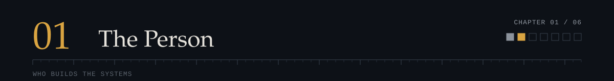
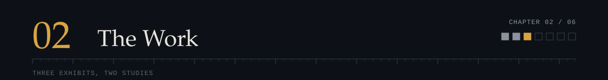
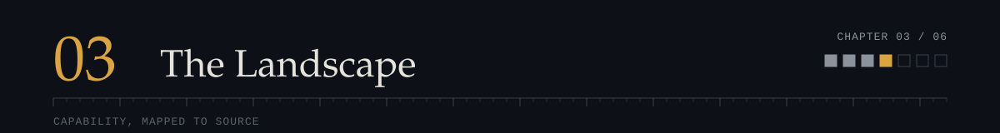
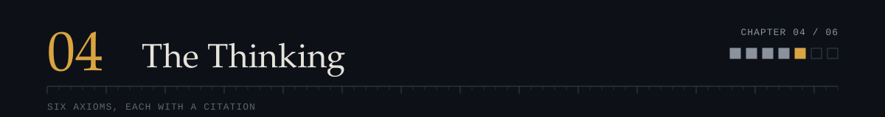
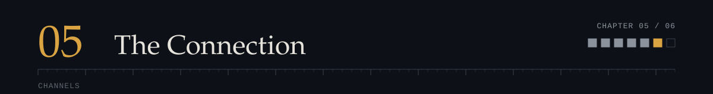
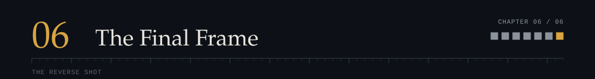

<!--
  Profile README for github.com/priyaansh21
  Plates are generated by tools/build_assets.py; edit the script, not the SVGs.
  Every factual claim below cites a repository. Keep it that way.
-->

  

  FRAME 00 · THE VERDICT IS SHOWN FIRST

> A contractor holds a valid permission for `financial-records`. The request comes from the wrong network.
> IAM says **yes**. The system says **no**.
>
> That refusal comes from [CloudContextGuard](https://github.com/priyaansh21/CloudContextGuard). Every chapter below is evidence for how it was reached.

 

**Priyaansh Jaiswal** is a computer science undergraduate (B.Tech (Hons.), RV University, Bengaluru) who builds security systems around one question: *when should a machine believe what it is told?*

The answer, across these repositories, is: rarely, and only for a stated reason. An access request is not trusted because its credential is valid. A packet is not trusted because it looks ordinary. A QR code is not trusted because it decodes cleanly. Each project turns that suspicion into architecture. Independent checks feed a single, explainable decision, and the code says plainly which parts are real and which are simulated.

The working toolkit is Python and FastAPI on the backend, scikit-learn where a model earns its place, and React where an analyst needs to see the reasoning. The current interests are access control, intrusion detection, phishing analysis, and the narrow space where machine learning and security engineering have to agree.

 

Three exhibits and two studies, ordered by depth of implementation rather than by date. Each states what it is: a working system, a simulation, or a prototype.

 

### Exhibit I · [CloudContextGuard](https://github.com/priyaansh21/CloudContextGuard)
*Context-aware cloud authorization, modelled locally with no real cloud account involved.*

| **Status** | Working implementation · local simulation, no cloud account |
|:---|:---|
| **Problem** | A stolen credential inherits every permission it carries, from any network. IAM alone answers the wrong question. |
| **Concept** | IAM permission is *necessary, not sufficient*. Identity, permission, network origin, resource policy, MFA and risk are evaluated independently on every request. |
| **Architecture** | Four evaluator engines (IAM, VPC, policy with MFA, risk) are pure functions that return structured, explainable results. A fifth, the **decision engine**, alone may produce `ALLOW` or `DENY`. The access service resolves the database and orchestrates. No engine queries it. |
| **Risk** | A deterministic 0–100 score with no hidden weights. Each point belongs to a named factor, e.g. *External network +40*, *Missing MFA +30*, *Repeated failed requests +10*. Levels: MEDIUM ≥ 30, HIGH ≥ 60, CRITICAL ≥ 80. |
| **Live policy** | Policies are re-read from the database on every request. An administrator's edit takes effect on the very next call, with no code change. |
| **Verification** | A written threat model (stolen credentials, untrusted VPC, missing MFA, privilege escalation, repeated probing), an attack-simulation lab, and 82 test functions across five pytest files. |
| **Stack** | `FastAPI` `SQLAlchemy 2` `Pydantic 2` `SQLite` `pytest` · `React 19` `Vite` `Tailwind 4` `Recharts` |

 

### Exhibit II · [SentinelSphere NIDS](https://github.com/priyaansh21/NIDS)
*A hybrid network intrusion detection system with a live SOC dashboard.*

| **Status** | Working implementation · live capture or simulator · synthetic training data |
|:---|:---|
| **Problem** | Fixed rules miss novel traffic, and models alone are hard to trust at 3 a.m. An analyst needs both, plus a clear account of which one fired. |
| **Concept** | Signatures for the known, anomaly scoring for the unknown. **Signature hits override the model.** The model still contributes confidence for triage. |
| **Pipeline** | Scapy `AsyncSniffer` captures traffic and falls back to a traffic simulator when capture privileges are missing. Per-source rolling state tracks SYN and ICMP rates over **10 s**, unique ports and flow volume over **30 s**, and authentication attempts over **60 s**. |
| **Detection** | Five signatures (SYN flood, ICMP flood, port scan, brute force, ARP spoofing) and two models: `IsolationForest` scores anomalies and `RandomForest` classifies attacks into *Normal · DoS/DDoS · Probe · R2L · U2R*. |
| **Interface** | JWT-authenticated admin and analyst roles, SQLite telemetry, a WebSocket stream to a React dashboard, attack replay, and CSV and PDF export. |
| **Honest note** | The models are trained on a synthetic dataset that the project generates itself. The plate reports architecture, not detection rates. |
| **Stack** | `Python` `Scapy` `scikit-learn` `FastAPI` `SQLite` `WebSockets` · `React` `Recharts` `Framer Motion` |

 

### Exhibit III · [QR Shield](https://github.com/priyaansh21/QR-Fishing-Detector)
*Phishing analysis for QR codes, from the image to the verdict.*

| **Status** | Working implementation · prototype-scale training data |
|:---|:---|
| **Problem** | A QR code hides its destination until after the scan, which makes it a convenient wrapper for phishing links. |
| **Concept** | Decode first, then interrogate the URL in ordered layers. Each layer adds a named reason to the score. |
| **Layers** | **Analyst feedback** overrides everything. Then reputation (blocklist, raw-IP hosts, suspicious TLDs), patterns (homographs, punycode, obfuscation, brand typosquatting), a gradient-boosting model over **30 lexical features** including URL and domain entropy, and live verification of SSL validity and redirect chains. |
| **Delivery** | A FastAPI service with batch analysis and CSV export, a web front end, and a Manifest V3 browser extension. |
| **Honest note** | The training sets are prototype-scale. Treat the model as one signal among five, as the pipeline itself does. |
| **Stack** | `OpenCV` `pyzbar` `Pillow` `scikit-learn` `FastAPI` `SQLite` · `Chrome MV3` |

 

### Studies IV & V · Architecture at prototype stage

**[MalSim](https://github.com/priyaansh21/malsim-backend)** is a malware-analysis *pipeline* study built as an async FastAPI service with upload validation, rate limiting and a composite threat score (`static × 0.35 + dynamic × 0.30 + YARA × 0.20 + network × 0.15`). Scores map to CLEAN, LOW (≥ 10), MEDIUM (≥ 40) and HIGH (≥ 70). File hashes (SHA-256, SHA-1, MD5) are computed, and so is Shannon entropy for uploads outside the built-in demo profiles. The sandbox and YARA stages are **simulated**, so it shows how the scoring is designed, not a working detonation environment.

**[HEALIX / CORTEX-SHIELD](https://github.com/priyaansh21/CORTEX-SHIELD)** is a hackathon prototype of a governed incident-response pipeline for e-commerce migrations. Each signal passes *ingest → context → reason → govern → act → learn*, and payments, auth and infra specialist agents vote on hypotheses. A governance table assigns each action domain its own autonomy, and **payment actions get zero autonomy and always require approval**. An LLM bridge prefers a local Ollama model, falls back to OpenAI, and degrades to simulated reasoning when neither is reachable.

 

<b>The archive</b>: smaller and earlier work

 

| Repository | What it is | Built with |
|---|---|---|
| [StudyAssistant](https://github.com/priyaansh21/StudyAssistant) | Offline desktop tool that turns PDF, DOCX and PPTX course material into notes and practice questions with a local LLM | `Ollama` `CustomTkinter` `SQLite` |
| [NLP · Resume Ranker](https://github.com/priyaansh21/NLP) | Resume parsing and candidate ranking against a job description using TF-IDF cosine similarity and skill matching | `spaCy` `scikit-learn` `Streamlit` |
| [FinPlanPremium](https://github.com/priyaansh21/FinPlanPremium) | Personal-finance app for transactions, loans and goals, with JWT authentication | `React` `Vite` `Express` `Prisma` |
| [EnerVision-AI](https://github.com/priyaansh21/EnerVision-AI) | Energy-consumption forecasting dashboard with cost and carbon estimates | `scikit-learn` `Tkinter` `Matplotlib` |
| [IoT-SUMMER-INTERNSHIP](https://github.com/priyaansh21/IoT-SUMMER-INTERNSHIP) | Team project: Arduino access and alert system with RFID, an MQ2 fire sensor and an IR beam break | `Arduino C++` `MFRC522` |
| [FITBITE](https://github.com/priyaansh21/FITBITE-PYTHON-PROJECT) | Flask fitness and nutrition tracker | `Flask` `SQLite` |

 

Capabilities are listed only where source code supports them. Each row names the repositories where the evidence can be read.

| Domain | Evidence in code | Tools |
|---|---|---|
| **Security engineering** | Layered authorization, intrusion detection, phishing analysis, threat scoring: CloudContextGuard, SentinelSphere, QR Shield, MalSim | IAM/VPC/MFA modelling · threat modelling · signature rules · JWT · rate limiting |
| **Machine learning** | Anomaly detection, multiclass attack classification, URL classification, text similarity: SentinelSphere, QR Shield, Resume Ranker | `scikit-learn` · Isolation Forest · Random Forest · Gradient Boosting · TF-IDF |
| **LLMs & agents** | Local-first LLM integration and governed agent loops: HEALIX, StudyAssistant | `Ollama` · OpenAI API · multi-agent orchestration |
| **Networks & traffic** | Packet capture and feature extraction over rolling windows, plus VPC trust boundaries: SentinelSphere, CloudContextGuard | `Scapy` · TCP/IP · ARP · ICMP |
| **Backend & APIs** | REST and WebSocket services with typed schemas and persistence | `FastAPI` · `SQLAlchemy` · `Pydantic` · `Express` · `Prisma` · `SQLite` |
| **Interfaces** | Analyst dashboards and desktop tools | `React` · `Vite` · `Tailwind` · `Recharts` · `Streamlit` · `Tkinter` |
| **Testing & documentation** | pytest suites, a threat model, API and research documentation: CloudContextGuard | `pytest` · `httpx` |
| **Embedded & IoT** | One team Arduino project (sensors, RFID, alerts) | `Arduino` · `MFRC522` · `MQ2` |

 

Six working principles. Each is cited to the code that applies it.

**I. Necessary is not sufficient.**
A valid permission starts a decision. It does not settle one. *CloudContextGuard treats IAM PASS as the first of six required checks.*

**II. Every number should have a name.**
A risk score that cannot explain itself is just a guess. *CloudContextGuard's risk engine attaches every point to a named, human-readable factor.*

**III. One authority decides.**
Many components may observe, but only one may conclude. *In CloudContextGuard, four engines report and only the fifth, the decision engine, returns `ALLOW` or `DENY`.*

**IV. Rules for the known, models for the unknown.**
Signatures are fast and explainable, and anomaly models catch what no one wrote down. *In SentinelSphere, a signature hit overrides the model and the model still informs triage.*

**V. Humans keep the irreversible decisions.**
Autonomy should shrink as the cost of a mistake grows. *HEALIX gives payment actions zero autonomy, and QR Shield lets an analyst's verdict override its own model.*

**VI. Say what is simulated.**
A demonstration is only credible when it marks its own boundaries. *CloudContextGuard opens by stating that no real cloud resource is ever contacted. This page labels each exhibit the same way.*

 

<table>
  <tr>
    <td width="96" valign="top"></td>
    <td valign="top">
      <b>LinkedIn</b> · <a href="https://www.linkedin.com/in/priyaansh-jaiswal-05883b29a">priyaansh-jaiswal</a> 
      <b>GitHub</b> · <a href="https://github.com/priyaansh21">priyaansh21</a> 
      Correspondence about any of the work above is welcome.
    </td>
  </tr>
</table>

 

  

  FRAME 06 · THE SAME BUILDING, SEEN FROM THE OTHER SIDE

