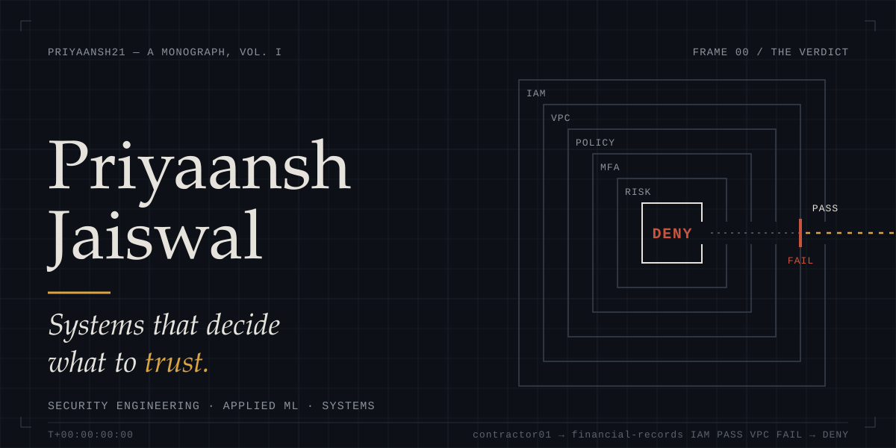
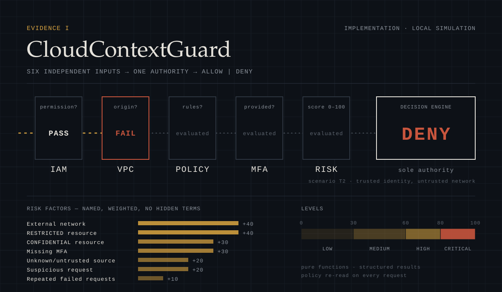
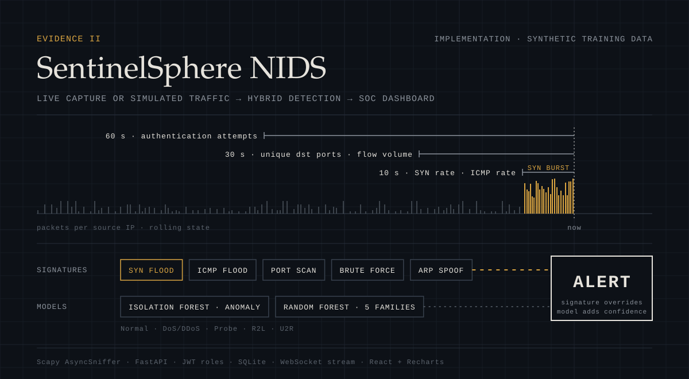
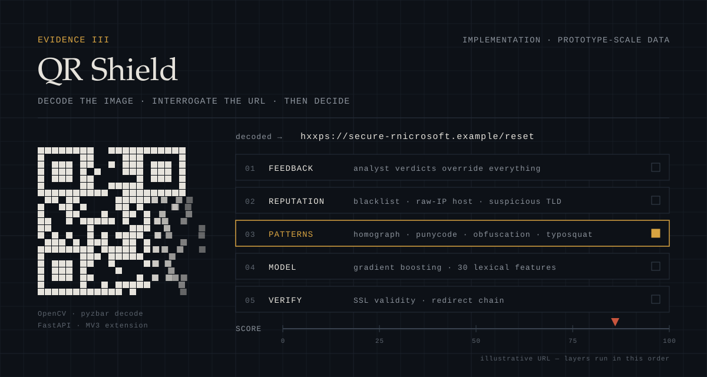
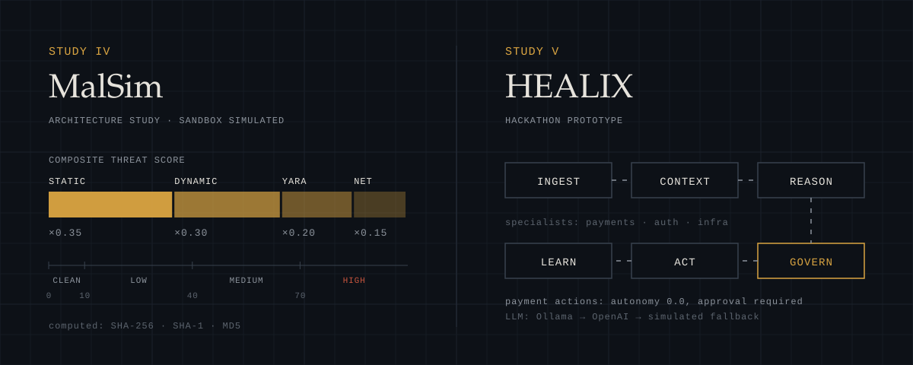
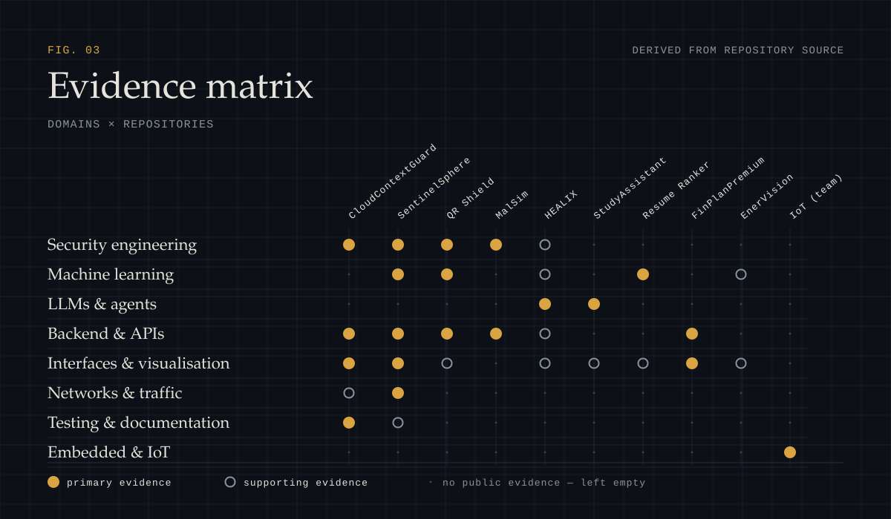
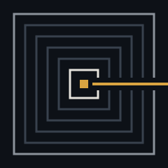
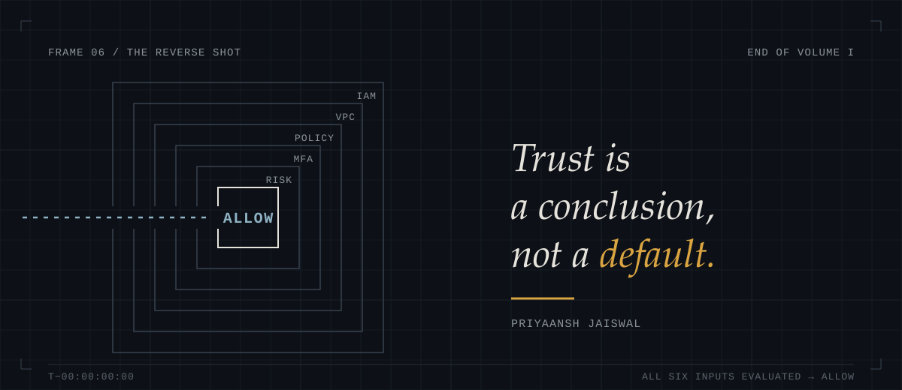

<!--
  Profile README for github.com/priyaansh21
  Plates are generated by tools/build_assets.py; edit the script, not the SVGs.
  Every factual claim below traces to a repository. Keep it that way.
-->

  

> A contractor holds a valid permission for `financial-records`. The request comes from the wrong network.
> IAM says **yes**. My system says **no**.

I'm Priyaansh, a B.Tech (Hons.) computer science student at RV University, Bengaluru. I build security systems around one question: *when should a machine believe what it is told?* My answer is rarely, and only for a stated reason. In my systems, independent checks feed a single decision that explains itself. I mostly work in Python and FastAPI, use scikit-learn where a model earns its place, and use React when an analyst needs to see the reasoning.

 

**[CloudContextGuard](https://github.com/priyaansh21/CloudContextGuard)**: I built a cloud authorization model in which a valid IAM permission is necessary but never sufficient. Network origin, policy, MFA and a named-factor risk score must agree, and one engine alone decides. It's a local simulation, with a threat model and 82 tests.

Details

- **Problem:** a stolen credential inherits every permission it carries, from any network.
- **Architecture:** four evaluator engines (IAM, VPC, policy with MFA, risk) are pure functions that return structured results. A fifth, the decision engine, alone produces `ALLOW` or `DENY`.
- **Risk:** a deterministic 0–100 score in which every point has a name, e.g. *External network +40*, *Missing MFA +30*, *Repeated failed requests +10*. Levels: MEDIUM ≥ 30, HIGH ≥ 60, CRITICAL ≥ 80.
- **Live policy:** policies are re-read on every request, so an admin's edit applies to the very next call.
- **Stack:** FastAPI · SQLAlchemy 2 · Pydantic 2 · SQLite · pytest · React 19 · Vite · Tailwind 4 · Recharts

 

**[SentinelSphere NIDS](https://github.com/priyaansh21/NIDS)**: I built a hybrid intrusion detection system that uses signatures for known attacks and anomaly models for the rest. When both fire, the signature wins and the model adds confidence for triage. It streams live to a SOC dashboard.

Details

- **Capture:** Scapy `AsyncSniffer`, with a traffic simulator as fallback when capture privileges are missing.
- **Features:** per-source rolling windows of 10 s (SYN and ICMP rate), 30 s (unique ports, flow volume) and 60 s (authentication attempts).
- **Detection:** five signatures (SYN flood, ICMP flood, port scan, brute force, ARP spoofing), plus Isolation Forest anomaly scoring and a Random Forest across five attack families.
- **Interface:** JWT roles, a WebSocket stream, attack replay, and CSV and PDF export.
- **Note:** the models are trained on synthetic data that the project generates itself.

 

**[QR Shield](https://github.com/priyaansh21/QR-Fishing-Detector)**: I built a QR phishing detector that decodes the image, then checks the URL in five ordered layers: analyst feedback, reputation, lookalike-domain patterns, a model, and live SSL and redirect checks. It runs as an API and as a browser extension.

Details

- **Patterns:** homographs, punycode, obfuscation and brand typosquatting.
- **Model:** gradient boosting over 30 lexical features, including URL and domain entropy. The training data is prototype-scale, so the model is one signal among five.
- **Delivery:** FastAPI with batch analysis, a web front end, and a Manifest V3 extension.
- **Stack:** OpenCV · pyzbar · scikit-learn · FastAPI · SQLite

 

<b>More work</b>: prototypes and smaller projects

 

| Project | What I built |
|---|---|
| [MalSim](https://github.com/priyaansh21/malsim-backend) | A malware-analysis pipeline that combines four weighted scores (static, dynamic, YARA, network). Hashing is real; the sandbox and YARA stages are simulated. |
| [HEALIX / CORTEX-SHIELD](https://github.com/priyaansh21/CORTEX-SHIELD) | A hackathon prototype of an agent pipeline for incident response. Payment actions get zero autonomy and always need human approval. |
| [StudyAssistant](https://github.com/priyaansh21/StudyAssistant) | An offline tool that turns course slides and PDFs into notes and practice questions using a local LLM (Ollama). |
| [NLP · Resume Ranker](https://github.com/priyaansh21/NLP) | Ranks resumes against a job description with TF-IDF similarity and skill matching (spaCy, Streamlit). |
| [FinPlanPremium](https://github.com/priyaansh21/FinPlanPremium) | A personal-finance app built with React, Express, Prisma and JWT auth. |
| [EnerVision-AI](https://github.com/priyaansh21/EnerVision-AI) | Energy-use forecasting with cost and carbon estimates. |
| [IoT-SUMMER-INTERNSHIP](https://github.com/priyaansh21/IoT-SUMMER-INTERNSHIP) | A team Arduino project: RFID access with fire and IR-beam alerts. |

 

 

**How I build**

- A valid permission starts a decision. It doesn't settle one.
- Every number in a risk score should have a name.
- Many components may observe, but only one may decide.
- I use rules for known threats and models for unknown ones.
- Humans keep the decisions that can't be undone.
- I say plainly what is simulated.

 

  &nbsp;
  <a href="https://www.linkedin.com/in/priyaansh-jaiswal-05883b29a"><b>LinkedIn</b></a> · <a href="https://github.com/priyaansh21"><b>GitHub</b></a>

  

